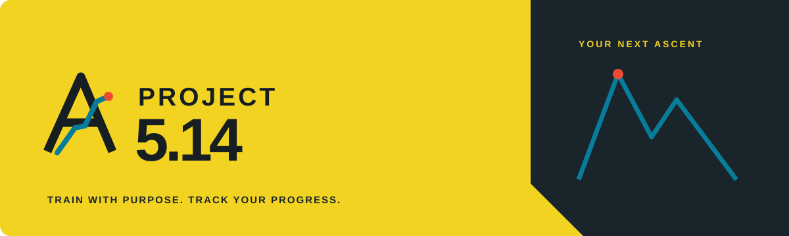

# Project 5.14



Your own private, password-protected climbing training log. Build a personalized 12-week calendar, optionally add mountaineering, running or cycling, and adjust the plan as you record progress.

## Set up your app

You need a GitHub account, a [free Cloudflare account](https://dash.cloudflare.com/sign-up), [Node.js 24 LTS](https://nodejs.org/en/download) with npm, and Git. The app uses Cloudflare Workers and a D1 database in your own account. [Workers allowances](https://developers.cloudflare.com/workers/platform/pricing/) · [D1 allowances](https://developers.cloudflare.com/d1/platform/pricing/)

1. **Fork and download.** Select **Fork → Create fork** on GitHub. Copy your fork’s HTTPS URL from **Code**, then run these commands in Terminal or PowerShell, replacing `YOUR-FORK-URL`.

   ```sh
   git clone YOUR-FORK-URL project-514
   cd project-514
   npm ci
   ```

2. **Connect Cloudflare.** Stay on the Free plan. Run this command and approve the browser login for your own account. Choose a free `workers.dev` subdomain in **Workers & Pages** if prompted.

   ```sh
   npx wrangler login
   ```

3. **Create a database.** Decline any offer to update the configuration automatically, then copy the database UUID printed by this command.

   ```sh
   npx wrangler d1 create project-514
   ```

4. **Save the UUID.** Open `wrangler.jsonc`. Replace `00000000-0000-0000-0000-000000000000` with your database UUID, keeping the binding named `DB`. If your account already uses the name `project-514`, choose unused Worker and database names and use them consistently in the configuration and commands.

5. **Initialize and deploy.** Accept the migration prompt. Deployment prints your private app’s HTTPS address.

   ```sh
   npx wrangler d1 migrations apply DB --remote
   npm run deploy
   ```

6. **Set your password.** Generate and save a unique password of at least 16 characters in your password manager. Paste it at the hidden prompt below. Anyone with this password can access your training log. Repeat this command to change it and invalidate existing sessions.

   ```sh
   npx wrangler secret put APP_PASSWORD
   ```

7. **Open your app.** Bookmark the deployment URL, typically `https://project-514.YOUR-SUBDOMAIN.workers.dev`. Enter your password, click the rope animation to enter, then choose units, climbing grades and your training profile. Select **Create my 12-week plan**.

Your profile and training history live in your own D1 database. Keep passwords, exports and personal databases out of your public fork.

## Your first training block

- **Profile** sets climbing goals, target dates and training days. Optional fields add cardio, hangboarding, strength, and daily carbohydrate, protein, fat and calorie references. Leave fueling targets blank to hide calendar fueling guidance. You can update your profile later.
- **Calendar** offers week and 12-week views. Select a day for its session, technique cues and any strength or hangboard work. Hover or focus the block-volume chart to explore weekly totals.
- **Progress** lets you report previous workouts and update benchmarks. Reports and profile changes adjust the remaining plan. Unreported workouts count as completed as directed. Optional reviews appear every two weeks.
- **Training research**, linked in the footer, explains the routines and links to supporting sources.

The first block begins the day after setup in your training time zone. Start another 12-week block when it ends. Use **Profile → Export my training log** to save a private backup.

Your password stays active across logo clicks, refreshes and new tabs within a browser session. A new session or device asks again. **Lock app** signs out. Browsers that restore sessions may also restore the session cookie.

## Preview on your computer

Install Python 3.12 as well as Node.js, then run `python3 start_demo.py` on Mac or `py -3.12 start_demo.py` on Windows. The launcher creates a local database, prints the URL to open in Chrome and saves your local password in the ignored `.dev.vars` file. Leave the terminal running while you use the app. Local data is separate from your hosted app.

## Keep your app updated

Sync your fork on GitHub, then run these commands in your local project folder. Confirm that `wrangler.jsonc` still contains your database UUID before deploying. Keep the same Worker name and database to preserve your URL and history.

```sh
git pull
npm ci
npx wrangler d1 migrations apply DB --remote
npm run deploy
```

Previous Streamlit users can find [log migration instructions in the archive](archive/README.md).
