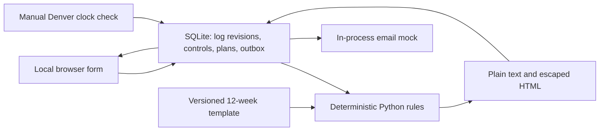

# MVP architecture and decisions

The starting checkout was `main` with one empty README. The implementation sequence was typed rules and templates, transactional check-ins, rendering and mock delivery, then simulation and pilot verification.

| Decision | MVP implementation | Production decision |
|---|---|---|
| HTTP and validation | FastAPI plus Pydantic, responsive HTML with no JavaScript required | Choose hosting and add real authentication, HTTPS and deployment controls |
| State | SQLite, schema v1, foreign keys, serialized writes and append-only check-in revisions | Decide whether a single-instance durable disk suffices or use PostgreSQL; establish migration, backup and restore |
| Timing | Manually invoked due check at 06:00–06:29:59 Denver time; timestamps stored in UTC | Choose a timezone-aware scheduler, alert on timing variance, and rehearse replay |
| Email | Atomic plan and outbox preparation, conditional claim, mock-only transport | Choose provider and reconcile ambiguous deliveries with provider idempotency or receipts |
| Narration | Deterministic fallback with an optional interface limited to selecting an approved cue | Keep optional, require data handling and cost review before connecting any service |

## Training, safety and nutrition

- Program weeks are seven-day windows from a configurable date. Sessions follow Denver weekdays even with a midweek start; a Monday start keeps week boundaries aligned with Sunday reports. Friday is rest. Weeks 4 and 8 deload, and week 12 tapers. W1 route work stays controlled, and no hangs are prescribed. W5 introduces route pairs and W6 introduces a limited running interval option while holding climbing dosage steady. W9–11 alternate pair/project/pair. A healthy log can support the scheduled ceiling; discretionary weekly increases are off.
- Red flags and repeated discomfort block training. A significant or acute flag remains in force even if the entry is corrected. A separate manual review is audited, followed by a two-day easy return, while repeated recent discomfort still gates training. New or concerning chest or breathing symptoms prompt urgent guidance. The system cannot diagnose or clear someone to exercise.
- Recent effort of 9/10 or pump of 8/10, poor recovery/fueling, missing logs, or a requested reduction trigger a hold. Yellow typically reduces volume by at least 30%, capped at the last same-weekday prescribed dose or reentry if no comparable day exists. One isolated missing input on Day 1 allows its conservative reentry baseline. Recent supplementary hangs or discomfort remove climbing load. Hard finger prescriptions are separated by 48 hours using the logged submission time as a conservative upper bound on session end, or the end of that day when the session is unverified. This can downshift Monday after Saturday. A missed session is never carried over.
- Running intervals stay controlled and require explicit clearance and green readiness. The web demo uses unknown clearance. Form overrides only reduce load. Resuming a paused cycle caps the next seven days at easy reentry loads. There is no catch-up or volume above published caps.
- Provisional calories come directly from macro arithmetic. The resting-expenditure equation is separate from daily fueling targets. Optional calibration compares two seven-day bands with at least three observations each and may suggest a modest increase for owner review. It never automatically changes targets, recommends restriction, or persists weights. Benchmarks use the technique and effort metrics already in the form; matched route and gym conditions are a manual pilot review, with no automated benchmark trend claim.
- One technique theme per week, a stable lesson ID per day, and curated motivation avoid claims about unlogged progress. Sunday reports use actual log revisions available at preparation; unlogged metrics remain unknown.

## Local privacy and failure boundaries

The synthetic app binds to loopback and disables access logs. The owner enters via a random per-process URL. Email link capabilities expire after 36 hours and are scoped to one cycle and date. The browser exchanges a capability for an HTTP-only, SameSite cookie, then redirects to a clean URL. Dashboard sessions last an hour. A restart invalidates existing signed links, and the dashboard still opens stored previews and check-in forms after fresh login. Exported sample links are illustrative. Local controls use filesystem access as their authority.

Host/origin checks, scoped CSRF, input size limits, a local request budget, optimistic check-in revisions and escaping protect the test form. A copied capability can be reused before expiration; revision checks prevent replaying an already-saved form. The loopback database and rendered content can contain synthetic observations. The app has no third-party assets, free-form health notes, real recipient addresses, provider secret values, background scheduler or production adapters.

Only the built-in email mock may dispatch. Prepared content and its decision are durable even on timeout. Explicit rechecks after one and two minutes handle transient mock timeouts, with three attempts maximum and a 30-minute due window. A process crash after claiming a row leaves it in `sending` for inspection and never triggers an automatic duplicate. Production would need provider reconciliation, authentication and revocation, distributed rate limits, data export/deletion and retention enforcement, redaction, monitoring, encrypted backups, and a durable review/recovery procedure.

The installed demo requires no external service credentials. Production scope and estimates are listed in the [pilot runbook](pilot.md).
